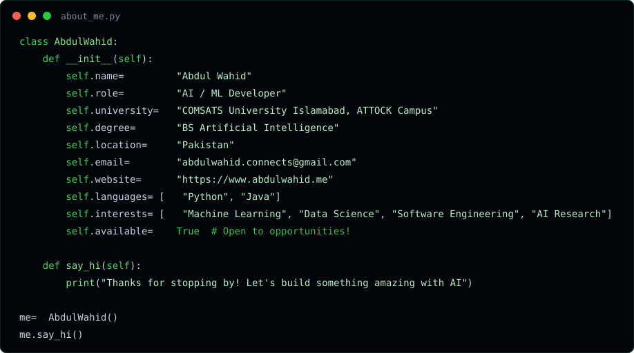
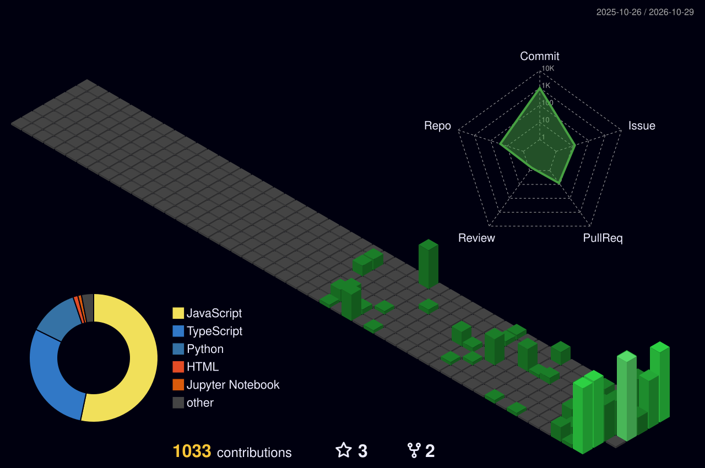

 

---

## About Me

---

## Connect With Me

[![Portfolio](https://img.shields.io/badge/-0E4429?style=for-the-badge&logo=data:image/png;base64,iVBORw0KGgoAAAANSUhEUgAAAGQAAABkCAYAAABw4pVUAAAACXBIWXMAAAsTAAALEwEAmpwYAAADbklEQVR4nO3dSWwOYRzH8VFLbAdx4G6Jm1oOtsYWBxJpbT1y4OJGXIh9uSFOEluLiDiUoBJngpCII9JYDhUJTiSWkpKvPOkjepDq23nmff7zzO%2BTTNKkms5%2Fvkpn3uedyTIRERERERERERHJDRgFtAA7A23NwMjYc5USMB3oIrznwLTY85XxJ6OrgBj9o%2BgnZbCANRSvOUsJMB5Y4P%2BNbw28Xa5DkMsF7HeLPybj6hliNnAD6KnDQSsrd2yuA41FhhgGHAR%2BxZ62RNyx2ueOXRFBTsSersSOh46xPvZECVgTKsYI4GXsaRLwAhgeIsiy2JMkZHGIIIdjT5GQQyGCXIg9RULaQwTpiD1FQjoUxBYFMUZBjFEQYxTEmKSDfPH7thVY7Tf38VXgKzYlG%2BQUMGmAfZ4MnMWe5IL0Ahtr2PdNwE%2FsSC7ItiHs%2F3bsSCrIo6G%2B0AM8wIakgqzMMcMqbEgmyMc8y3b8sqJPsYdIKciDAHM8jD1ESkE6A8zRGXuIlILcCzDH%2FdhDpBTkPdCQY4YG4EPsIVIK4izIMcNCbEgqyM0cM9zChqSCDGltE7AOO5IL8hlYVMO%2BN%2FmvsSK5IM53d01roBNFfyK4A%2FiBLUkG%2BeOVXzO2BJjiN%2FfxEeA1NiUdpIwUxBgFMSbpIN3%2Bcsht4IrfbvvXPtznLEomSDdwCdgMzHXvbxzkeyDdn93iv%2FZN7CHKHuQpsMv99pR7iL%2BzTAV2A88izVS6IL3AeWBWkAL%2Ff%2FPqBf8966U0QdzKkIvub3CQo137HSMu1Wl1SimCuLd6zQ9ydHPwV4TdyWalg9wBJmRGABOBu1UN8riudzwYJP%2Fb2ZOqBXEXCGdkRtH3%2F0pPlYKcy4wD2qsUpLmidyTqsBpkTmYcfWf5lQmyNDMOWF6lIHsz44ADVQryFhiTGQWMLuiKsdkgzsnMKOB0QTObDuKcsXRySN9JYVuB85oP4rwDjgEbgBWRNve9j%2Fslq1Q9SJV0KIgtCmKMghijIMYoSIpB3KIDCaMtRBDdBDOcgyGCuBXlEkZTiCDD%2FcoQyacryI2UfZS1OXdGCPwqqb%2FWI0NzNGiMfo%2Br2K%2FHVdTEHas9hTyuol%2BYRv%2Bwkm%2B17VulfAOuATMLC%2FGPMOOAeQU98qi1pFuLPyZj6xZCREREREREREREREQkK5ffsLFpVV%2F956wAAAAASUVORK5CYII%3D)](https://www.abdulwahid.me)

---

## Tech Stack & Skills

**Languages** 

  

**AI / Machine Learning** 

  

**Web & Backend** 

  

**Tools & Platforms** 

---

## GitHub Stats

 
 

---

## Education

| Degree | Institution | Semester | CGPA |
|:------:|:-----------:|:------:|:------:|
| BS Artificial Intelligence | COMSATS University Islamabad, ATTOCK Campus | 5th | 3.46 |

---

<h2 align="center">Certificates & Achievements</h2>

**[View Full Certificates Repository →](https://github.com/abduIwahid/certificates)**

| Credential | Issuer | Date | Skills | Proof |
|:-----------|:-------|:-----|:-------|:------|
| [**Google AI Essentials**](https://github.com/abduIwahid/certificates/tree/main/google-ai-essentials) Specialization · 5 Courses | Google via Coursera | May 2026 | AI · Prompt Engineering · Productivity | [Verify](https://coursera.org/verify/specialization/ET3L35MRSLBI) |
| [**ML with NumPy, pandas**](https://github.com/abduIwahid/certificates/tree/main/machine-learning-numpy-pandas) Completion · 15 Hours | Educative.io | May 2026 | NumPy · pandas · scikit-learn | [Verify](https://drive.google.com/file/d/1iCF1dC5lXYNjqLK-9EoYhNlrG8B_9QV0/view) |
| [**MTM AI Hackathon**](https://github.com/abduIwahid/certificates/tree/main/mtm-ai-hackathon-2026) Participation | GDGoC, COMSATS Wah | May 12, 2026 | AI Hackathon · Problem Solving | [Verify](https://drive.google.com/file/d/1UGs2P9JgDlXth--FgMtQXr_n10pAjnsu/view) |

---

<h2 align="center">Recent Projects & Contributions</h2>

<!-- PROJECTS:START -->
<table>
  <tr>
    <td width="24%" valign="top"><a href="https://github.com/abduIwahid/WhyRisk"><b>WhyRisk</b></a> TypeScript</td>
    <td valign="top">AI healthcare platform for diabetes risk prediction with explainable ML (SHAP) — Next.js, FastAPI and Supabase.           <a href="https://github.com/abduIwahid/WhyRisk">Repository</a> · <a href="https://whyrisk.vercel.app">Live Demo</a></td>
  </tr>
  <tr>
    <td width="24%" valign="top"><a href="https://github.com/abduIwahid/Portfolio"><b>Portfolio</b></a> TypeScript</td>
    <td valign="top">Personal portfolio of Abdul Wahid — AI/ML Developer &amp; BS AI student at COMSATS Attock. Built with HTML, CSS &amp; JS. Live at abdulwahid.me       <a href="https://github.com/abduIwahid/Portfolio">Repository</a> · <a href="https://www.abdulwahid.me">Live Demo</a></td>
  </tr>
  <tr>
    <td width="24%" valign="top"><a href="https://github.com/abduIwahid/psx-investment-agent"><b>psx investment agent</b></a> Python</td>
    <td valign="top">  <a href="https://github.com/abduIwahid/psx-investment-agent">Repository</a></td>
  </tr>
  <tr>
    <td width="24%" valign="top"><a href="https://github.com/abduIwahid/agentic-rag-agent"><b>agentic rag agent</b></a> Python</td>
    <td valign="top">  <a href="https://github.com/abduIwahid/agentic-rag-agent">Repository</a></td>
  </tr>
  <tr>
    <td width="24%" valign="top"><a href="https://github.com/abduIwahid/ai-data-analyst"><b>ai data analyst</b></a> Python</td>
    <td valign="top">  <a href="https://github.com/abduIwahid/ai-data-analyst">Repository</a></td>
  </tr>
  <tr>
    <td width="24%" valign="top"><a href="https://github.com/abduIwahid/github-mcp-agent"><b>github mcp agent</b></a> Python</td>
    <td valign="top">  <a href="https://github.com/abduIwahid/github-mcp-agent">Repository</a></td>
  </tr>
  <tr>
    <td width="24%" valign="top"><a href="https://github.com/abduIwahid/ai-deep-research-agent"><b>ai deep research agent</b></a></td>
    <td valign="top">  <a href="https://github.com/abduIwahid/ai-deep-research-agent">Repository</a></td>
  </tr>
  <tr>
    <td width="24%" valign="top"><a href="https://github.com/abduIwahid/Pac-Man"><b>Pac Man</b></a> Jupyter Notebook</td>
    <td valign="top">Navigate a neon-lit maze as Pac-Man, a hungry yellow icon on a mission to consume every pellet in sight. But you aren’t alone—3-4 ghosts are in hot pursuit. Chomp a Power Pellet to turn the tables, sending the ghosts running as you rack up points. It’s a timeless, high-score chase of pure arcade magic!  <a href="https://github.com/abduIwahid/Pac-Man">Repository</a></td>
  </tr>
</table>
<!-- PROJECTS:END -->

<b>More projects</b>

 

<table>
  <tr>
    <td width="24%" valign="top"><a href="https://github.com/abduIwahid/Freelance-MarketPlace-Management-System"><b>Freelance Marketplace Management System</b></a></td>
    <td valign="top">
      SQL-based backend for managing freelancers, clients, projects, bids, and payments. Focuses on efficient data design, optimized queries, and secure transactions.  
      
    </td>
  </tr>
  <tr>
    <td valign="top"><a href="https://github.com/abduIwahid/Inventory-Management-System"><b>Inventory Management System</b></a></td>
    <td valign="top">
      OOP-based Java project (built in NetBeans) for managing products, stock levels, sales, and suppliers, using classes, inheritance, and encapsulation.  
      
    </td>
  </tr>
  <tr>
    <td valign="top"><a href="https://github.com/abduIwahid/Pac-Man"><b>Pac-Man</b></a></td>
    <td valign="top">
      A maze game: eat every pellet while 3-4 ghosts chase you, and grab a Power Pellet to turn the tables.  
      
    </td>
  </tr>
</table>

---

<h2 align="center">What I'm Working On</h2>

<table>
  <tr><td>Building intelligent AI/ML solutions for real-world problems</td></tr>
  <tr><td>Exploring data science and predictive modeling</td></tr>
  <tr><td>Deepening expertise in deep learning and neural networks</td></tr>
  <tr><td>Developing my portfolio at <a href="https://www.abdulwahid.me">abdulwahid.me</a></td></tr>
  <tr><td>Growing <a href="https://github.com/abduIwahid/fa24-bai">Study Hubb</a> and shipping EPMS</td></tr>
</table>

---

<h2 align="center">Fun Facts</h2>

> *I see every problem as a dataset waiting to be understood.*
>
> *Python is my weapon of choice for ML experimentation.*
>
> *Goal: leverage AI to make a real-world impact.*

---

⭐ **If you find my projects useful, consider giving them a star!** ⭐

